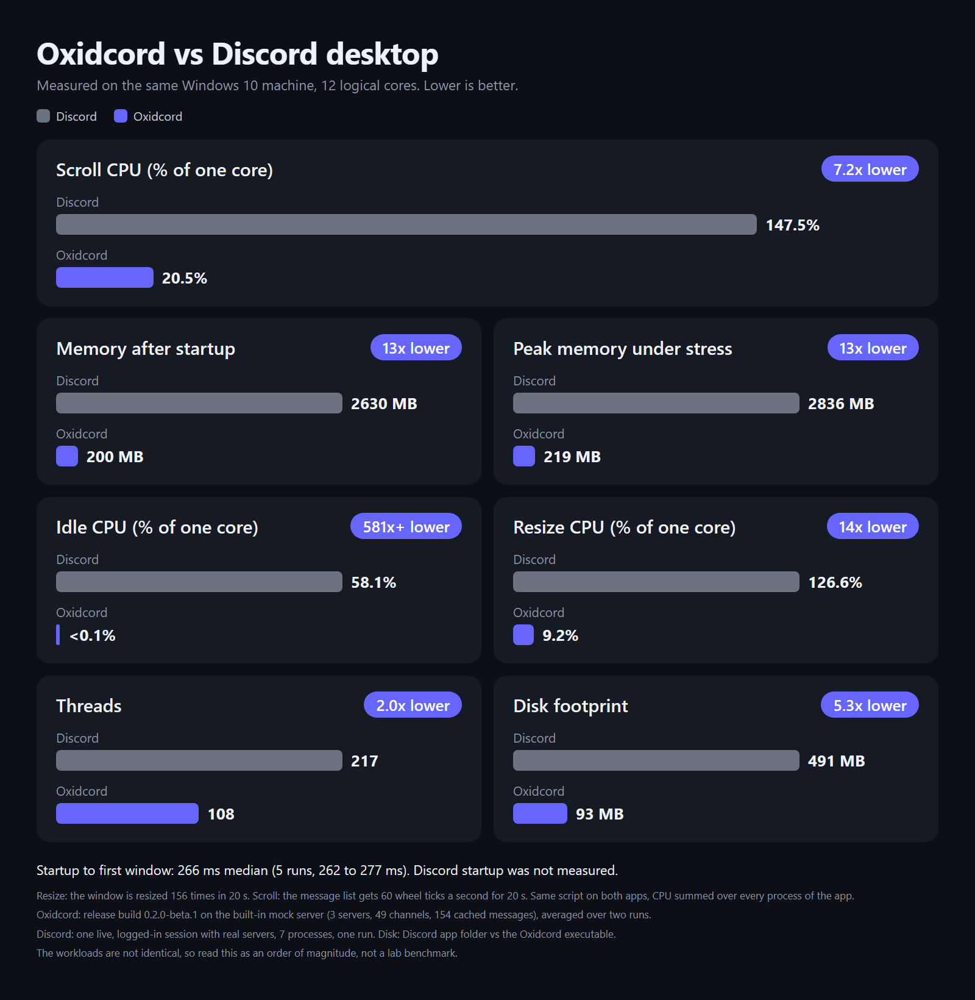

<p align="center">
	
</p>

<h1 align="center">Oxidcord</h1>

<p align="center">A native Discord client written in Rust, with a sandboxed WebAssembly plugin system.</p>

> **Oxidcord is not an official Discord product. It is not made, endorsed, sponsored or supported by Discord Inc.**
>
> **Using a third-party client with a Discord user account can violate the Discord Terms of Service and Community Guidelines. Your account can be rate limited, flagged, locked, suspended or permanently banned, with or without warning. If you are not willing to lose the account, do not use this software with it.**
>
> **This software is a beta. It is provided as is, with no warranty of any kind, and the authors accept no liability for anything that happens as a result of using it. Read [Disclaimer](#disclaimer) before you install.**

## Contents

- [What it is](#what-it-is)
- [Performance](#performance)
- [Install](#install)
- [First run](#first-run)
- [Everyday use](#everyday-use)
- [Plugins](#plugins)
- [Where your data lives](#where-your-data-lives)
- [Build from source](#build-from-source)
- [Disclaimer](#disclaimer)
- [Privacy and security](#privacy-and-security)
- [Contributing](#contributing)
- [License](#license)

## What it is

- Native, GPU rendered window. No web view for the main interface.
- WebAssembly plugins with a versioned API and a default-deny permission model.
- No telemetry, no analytics, no crash upload, no remote logging.
- Session token kept in the operating system credential store. The local message cache is encrypted with a key held in the same store.
- Windows, macOS and Linux.

## Performance

<p align="center">
	
</p>

Measured on one Windows 10 machine with 12 logical cores. Oxidcord is the 0.2.0-beta.1 release build running against its built-in mock server, averaged over two runs. Discord is a live, logged-in session with real servers, so the workloads differ and the numbers show an order of magnitude, not a lab result.

- Scrolling the message list at 60 wheel ticks a second for 20 seconds: 20.5% of one core against 147.5%.
- Idle memory 200 MB against 2630 MB, idle CPU under 0.1% against 58.1%.
- Resizing the window 156 times in 20 seconds: 9.2% of one core against 126.6%, peak memory 219 MB against 2836 MB.
- Startup to first window: 266 ms median over 5 runs (262 to 277 ms).

Discord startup time was not measured, because that would mean closing a running session.

## Install

Download the package for your system from the [releases page](https://github.com/Master0fFate/oxidcord/releases). Versions with a `-beta` suffix are pre-releases.

| System | File | Notes |
| --- | --- | --- |
| Windows | `oxidcord-<version>-windows-x86_64-installer.exe` | Per-user install, no administrator rights. A portable `.zip` is also published. |
| macOS | `oxidcord-<version>-macos-aarch64-dmg.dmg` or `macos-x86_64-dmg.dmg` | Apple silicon and Intel builds. |
| Linux | `.AppImage`, `.deb` or `.rpm` | x86_64. The AppImage needs no installation, `chmod +x` and run. |

Each release also contains `manifest.json` and `manifest.json.sig`. The in-app updater only installs a package whose sha256 matches the manifest and whose manifest carries a valid signature.

Beta builds are not code signed with a paid developer certificate. Expect these warnings, they are normal for unsigned software and are your cue to check that you downloaded the file from this repository:

- Windows SmartScreen: choose **More info**, then **Run anyway**.
- macOS Gatekeeper: right click the app, choose **Open**, then confirm. If macOS still refuses, run `xattr -dr com.apple.quarantine /Applications/Oxidcord.app`.
- Linux: the AppImage may need FUSE 2 (`libfuse2`) on recent distributions.

## First run

1. Start Oxidcord. The login screen carries a notice about the Discord Terms of Service and account termination. Read it, and only continue if you accept the risk.
2. Sign in with one of the methods the login screen offers:
   - **QR code**: open Discord on your phone, go to Settings, Scan QR Code, and scan the code shown in Oxidcord.
   - **Web login**: sign in through a Discord login page in a separate window. Oxidcord only reads the resulting session.
   - **Token**: paste an existing session token. Never paste a token someone else gave you, and never share yours.
3. If the sign-in asks for multi-factor authentication or a captcha, complete it yourself. Oxidcord does not solve, skip or bypass either of them.
4. Your servers and direct messages load in the sidebar. The token is saved to the OS credential store (Windows Credential Manager, macOS Keychain, Secret Service on Linux).

Want to look around without an account? Run the built-in mock server. Nothing leaves your machine:

```bash
oxidcord --mock
```

## Everyday use

- Pick a server or direct message in the left sidebar and type in the composer at the bottom. Nothing is ever sent that you did not type or approve.
- Drag servers into folders and reorder them from the server list.
- Zoom the interface from the settings.
- Settings also cover notifications, keybinds, streamer mode, storage and plugins.
- Command line flags:

| Flag | Effect |
| --- | --- |
| `--mock` | Run against a local fake Discord server. |
| `--safe-mode` | Start with every plugin disabled. Use it if a plugin misbehaves. |
| `--data-dir <path>` | Keep settings, cache and logs under this folder, for example on a USB stick. |
| `--log <filter>` | Log level, for example `debug`. Logs never contain the token or raw gateway payloads. |

## Plugins

Plugins are WebAssembly components that run in a sandbox with no file access, no raw network access and no access to your token. Each one declares the permissions it wants in its manifest, and you grant or deny them when you install it. Denied calls return an error to the plugin instead of crashing it.

Plugins are third-party code. The sandbox limits what they can do, it does not make them trustworthy. Read the permissions list before you approve it, and be careful with `actions-send`, `net-fetch` and `context-private`. See `docs/plugin-api/` for the API and `plugins/README.md` for the plugins that ship in this repository.

## Where your data lives

| What | Windows | macOS | Linux |
| --- | --- | --- | --- |
| Data and cache database | `%APPDATA%\oxidcord\Oxidcord\data` | `~/Library/Application Support/dev.oxidcord.Oxidcord` | `~/.local/share/oxidcord` |
| Settings | `%APPDATA%\oxidcord\Oxidcord\config` | same folder | `~/.config/oxidcord` |

To remove everything, uninstall the app, delete those folders, and delete the `oxidcord` entries from your credential store. Signing out in the app removes the saved token.

## Build from source

You need the Rust toolchain pinned in `rust-toolchain.toml`.

- Windows: MSVC build tools and CMake.
- macOS: Xcode command line tools.
- Linux: ALSA, xkbcommon, Wayland, X11, fontconfig, dbus, WebKitGTK 4.1 and GTK 3 development headers, CMake and pkg-config.

```bash
git clone https://github.com/Master0fFate/oxidcord
cd oxidcord
cargo run --locked --release -p oxidcord -- --mock
```

Drop `--mock` to connect to Discord. Read `docs/architecture.md` for the crate layout and `CONTRIBUTING.md` before sending changes.

## Disclaimer

Please read all of this. By downloading, installing, building or running Oxidcord you agree to it.

**1. Not affiliated.** Oxidcord is an independent, unofficial project. It has no connection to Discord Inc. "Discord" and the Discord logo are trademarks of Discord Inc. They are used here only to say what the software is compatible with. The Oxidcord name, icon and interface are not meant to look like, and must not be mistaken for, an official Discord product.

**2. Terms of Service and account risk.** Discord's Terms of Service and Developer Policy restrict the use of unofficial or modified clients with user accounts. Oxidcord presents the client properties and request headers of Discord's web client, and that does not make it undetectable or permitted. Discord can tell clients apart by network fingerprint and by behavior. Using Oxidcord can lead to warnings, feature restrictions, captchas, forced password resets, temporary or permanent account suspension, loss of purchases and subscriptions, loss of access to servers and data, and in the worst case a permanent ban. These decisions are Discord's alone. Nobody here can reverse them, appeal them for you or compensate you.

**3. Use is entirely at your own risk.** You alone decide whether to use Oxidcord, with which account, and for what. Use a throwaway account if you are unsure. You are responsible for following the rules of Discord, of every server you join, and of the laws that apply to you.

**4. No warranty.** The software is provided "as is" and "as available", without warranty of any kind, express or implied, including merchantability, fitness for a particular purpose, non-infringement, accuracy, availability, security or freedom from bugs. This is beta software. It can crash, lose or corrupt local data, display messages incorrectly, fail to send or delete messages, or stop working without notice when Discord changes its service.

**5. No liability.** To the fullest extent permitted by law, the authors, maintainers and contributors are not liable for any claim, damage or loss arising from or connected to the software or its use. That includes, without limit, account suspension or termination, lost data, lost messages, lost money or digital goods, lost income, reputational harm, privacy incidents, token or account compromise, damage to your device, and any direct, indirect, incidental, special, consequential or punitive damages, even if advised that they were possible. If your jurisdiction does not allow some of these exclusions, they apply as far as the law lets them.

**6. You indemnify the authors.** You agree to hold the authors, maintainers and contributors harmless from claims by third parties, including Discord Inc., that come from your use of the software or your breach of someone else's terms or rights.

**7. Third-party code and content.** Plugins, themes, catalogs and links come from third parties. They are not reviewed for safety or legality in any binding way, a "reviewed" flag is not a guarantee, and you install them at your own risk. Messages and media you see come from Discord and other users, not from this project.

**8. No support, no guarantees of continuity.** There is no service level, no support obligation and no promise that releases, updates, the update channel or this repository will keep existing. A release can be pulled at any time, for example after a request from a rights holder.

**9. Not for abuse.** Oxidcord is meant for reading and writing your own messages like any other chat client. It does not automate user actions and does not bypass captchas, multi-factor authentication, rate limits or client verification, and you may not use it, or modify it, to spam, harass, scrape, self-bot, mass-message, evade bans, or break the law. Anyone who does that does it on their own account and their own responsibility.

**10. Not legal, security or financial advice.** Nothing in this repository is legal advice. If a legal question matters to you, ask a lawyer in your jurisdiction.

**11. Your token is your account.** Anyone holding your session token can act as you. Never post it, never paste it into software you do not trust, and never attach it to a bug report. If you think it leaked, change your Discord password, which invalidates it.

If you do not agree with any of this, do not use Oxidcord.

## Privacy and security

- No telemetry of any kind. The only network traffic is to Discord, to the public pages used to read the current Discord build number and Chrome version once a day, to GitHub for update checks, and to the media hosts Discord messages point at.
- The token is attached only to `https://discord.com` requests and is dropped on any redirect. It is never logged.
- Everything from the network, from a plugin or from disk is treated as untrusted and decoded leniently.
- The message cache is encrypted at rest with XChaCha20-Poly1305. The key lives in the OS credential store, or in a file next to the settings if you turn on the plaintext storage setting, which shows a warning. The channel and message ids and timestamps used to index the cache stay unencrypted.
- Updates are verified with sha256 and an ed25519 signature before they are installed, and a failed first start rolls back.

Report vulnerabilities privately as described in `SECURITY.md`, never in a public issue.

## Contributing

Read `AGENTS.md` and `CONTRIBUTING.md`. Other open source Discord clients may be read for protocol facts and ideas, but their source must not be copied into this project.

## License

Oxidcord is dual licensed under either of

- Apache License, Version 2.0 ([LICENSE-APACHE](LICENSE-APACHE))
- MIT license ([LICENSE-MIT](LICENSE-MIT))

at your option. Unless you state otherwise, any contribution you intentionally submit for inclusion in Oxidcord, as defined in the Apache-2.0 license, is dual licensed as above, without any additional terms or conditions.

Both licenses disclaim all warranties and limit liability, and the [Disclaimer](#disclaimer) above applies in addition to them. The licenses cover the source code of this repository. They give you no rights to Discord's name, marks, service or content. Third-party dependencies keep their own licenses, which `cargo deny check` verifies against the allow list in `deny.toml`.
